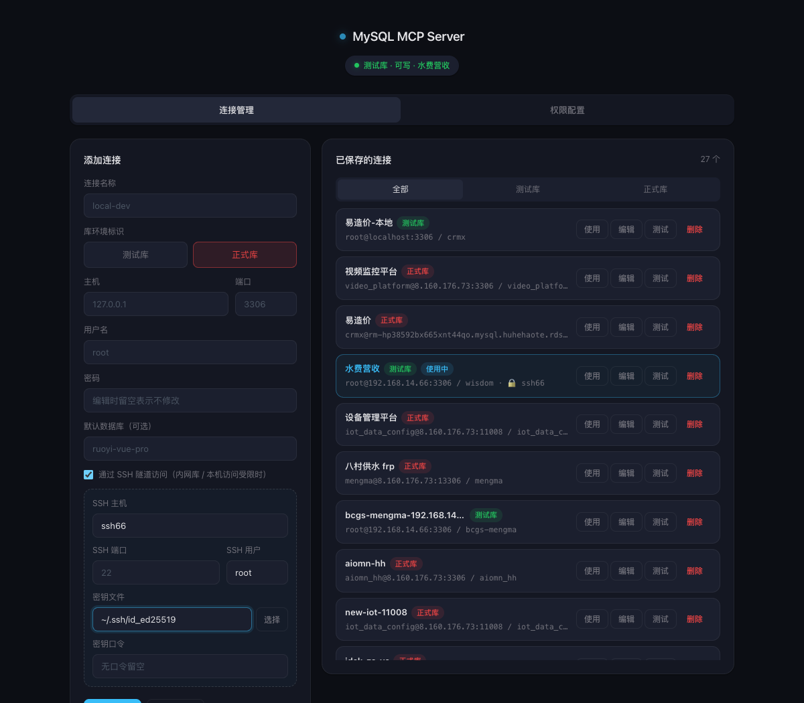
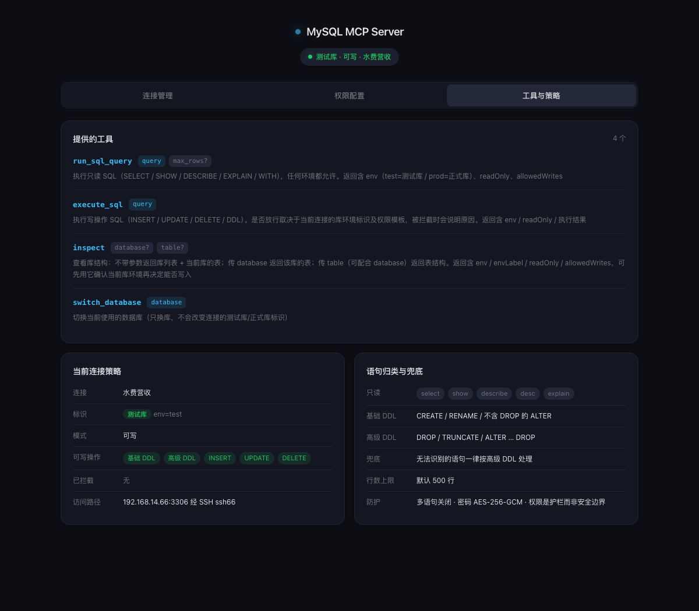

# MySQL MCP Server

> A MySQL tool layer for AI agents that **knows which database it is talking to**: per-connection test/prod tagging, fine-grained write permissions, SSH tunnels for intranet databases, and a visual web console.

[English](#english) · [中文](#中文)

---

## English

### Why This Server?

Every statement an agent runs happens somewhere specific — a database it is free to break, or the one real users depend on. This server makes that context part of the protocol:

1. **Where am I?** Every connection carries a `test` or `prod` tag, and every tool response reports it.
2. **What am I allowed to do here?** Five permission switches per tag, enforced before the statement ever reaches MySQL.
3. **How do I reach a database that only exists inside a private network?** A managed SSH tunnel.

The parts that do not belong in a chat — connection management, permission templates, and a live view of what the server exposes — live in a web console.

### Features

- **Four focused tools** — `run_sql_query`, `execute_sql`, `inspect`, `switch_database`, each with a single clear job
- **Environment tagging** — every connection is `test` or `prod`; permissions are bound to the tag, not the connection
- **5 granular write switches** — Basic DDL / Advanced DDL (DROP, TRUNCATE) / INSERT / UPDATE / DELETE. `prod` defaults to read-only
- **Self-describing results** — every tool response carries `env`, `envLabel`, `readOnly`, `allowedWrites`, so the model never has to guess
- **SSH tunnels** — reach intranet MySQL through a jump host; key file + optional passphrase, managed by the server
- **Web console** — three tabs: connections, permissions, tools & policy
- **Hot switching** — change the active connection in the UI; running MCP sessions follow automatically, no restart
- **Encrypted at rest** — passwords and SSH passphrases use AES-256-GCM

### Quick Start

```bash
git clone https://github.com/minivv/mysql-mcp-server.git
cd mysql-mcp-server
npm install
npm run build
```

Start it once so the web console opens at <http://localhost:3456>, add a connection, tag it, and click **Use**.

### MCP Client Configuration

```json
{
  "mcpServers": {
    "mysql": {
      "command": "node",
      "args": ["/path/to/mysql-mcp-server/build/index.js"],
      "env": {
        "MCP_OPEN_BROWSER": "false"
      }
    }
  }
}
```

Claude Desktop config lives at `~/Library/Application Support/Claude/claude_desktop_config.json` (macOS) or `%APPDATA%\Claude\claude_desktop_config.json` (Windows).

### Tools

| Tool | Arguments | Description |
|------|-----------|-------------|
| `run_sql_query` | `query`, `max_rows?` | Read-only SQL (`SELECT` / `SHOW` / `DESCRIBE` / `EXPLAIN` / read-only `WITH`). Allowed in every environment. Truncates at `max_rows` (default 500). |
| `execute_sql` | `query` | Write SQL (INSERT / UPDATE / DELETE / DDL). Gated by the environment tag and its permission template; a rejection explains which rule fired. |
| `inspect` | `database?`, `table?` | No arguments → databases + tables of the current database. `database` → its tables. `table` → table structure. |
| `switch_database` | `database` | Switch the current database. Does **not** change the test/prod tag. |

Example response:

```json
{
  "env": "prod",
  "envLabel": "正式库",
  "readOnly": true,
  "allowedWrites": [],
  "rowCount": 1,
  "rows": [{ "cnt": 42 }]
}
```

### Web UI



- **Connections** — add / edit / delete / test connections, tag as test or prod, filter the list, enable an SSH tunnel, one-click switch
- **Permissions** — five switches per tag (`test`, `prod`). Change a template once and every connection with that tag follows
- **Tools & Policy** — the live tool list with argument hints, the effective policy of the active connection, and the statement-classification rules

### Environment Permissions

Permissions are bound to the **tag**, not to individual connections.

| Operation | Statements | Default `test` | Default `prod` |
|-----------|------------|:--------------:|:--------------:|
| Basic DDL | CREATE / RENAME / ALTER without DROP | ✅ | ❌ |
| Advanced DDL | DROP / TRUNCATE / ALTER … DROP | ✅ | ❌ |
| INSERT | INSERT / REPLACE | ✅ | ❌ |
| UPDATE | UPDATE | ✅ | ❌ |
| DELETE | DELETE | ✅ | ❌ |
| Read | SELECT / SHOW / DESCRIBE / EXPLAIN / read-only WITH | ✅ | ✅ |

Statements are normalised before classification: leading `--`, `/* */` and `#` comments are stripped, and `WITH … DELETE` is recognised as a write — so `/* x */ DELETE …` does not slip through. Anything that cannot be classified is treated as **advanced DDL**, the strictest bucket.

### SSH Tunnels

For databases that only the jump host can see, enable **SSH tunnel** on the connection. The server spawns `ssh -N -L` itself and reuses the tunnel for the lifetime of the connection pool.

- **SSH host** — an alias from `~/.ssh/config` (e.g. `ssh66`), or an explicit host/user pair
- **Key file / passphrase** — optional; the passphrase is stored encrypted and fed to `ssh` through an ephemeral `SSH_ASKPASS` helper
- The connection's **host / port** then mean *"where MySQL listens as seen from the jump host"* (usually `127.0.0.1:3306`)
- Without a passphrase, auth runs in `BatchMode=yes`; configure passwordless key auth first
- The local forwarding port is picked automatically from `13306` upwards
- Tunnels are closed on connection switch / delete and on `SIGINT` / `SIGTERM`

```bash
# Pre-check: key auth must work without prompting
ssh -o BatchMode=yes <ssh-alias> echo OK
```

### Configuration Files

Everything lives in `~/.mysql-mcp/`:

| File | Contents |
|------|----------|
| `connections.json` | Saved connections, active connection, environment tags, SSH settings |
| `permissions.json` | The two permission templates (`test`, `prod`) |
| `.key` | AES-256-GCM key for passwords and passphrases (mode `0600`) |

### Environment Variables

```bash
MCP_WEB_PORT=3456          # Web console port (default 3456)
MCP_OPEN_BROWSER=false     # Do not auto-open the browser
MCP_WEB_UI=false           # Do not start the web console at all

# Legacy fallback, used only when no connection has been activated in the UI
MYSQL_HOST=127.0.0.1
MYSQL_PORT=3306
MYSQL_USER=root
MYSQL_PASSWORD=secret
MYSQL_DATABASE=app
MYSQL_ENV=prod             # test | prod, default prod
```

### Security

- Passwords and SSH passphrases are encrypted with AES-256-GCM; keys are written with mode `0600`
- `multipleStatements` is disabled — one query argument cannot smuggle a second statement
- Selections are capped by `max_rows` (default 500)
- The permission switches are a **guardrail, not a security boundary**. The real boundary is a least-privilege MySQL account per environment — use one.

### Development

```bash
npm install
npm run build     # tsc → build/
node build/index.js
```

Source layout: `src/index.ts` (MCP server, web API, SSH tunnels) and `src/web-ui.ts` (the console page, shipped as a single HTML string).

### License

MIT

---

## 中文

### 为什么用它

agent 执行的每一条 SQL 都发生在具体的某个地方——它可以随便搞坏的库，或者真实用户正在用的那个库。这个服务把「在哪儿」变成协议的一部分：

1. **我在哪？** 每个连接带 `test` / `prod` 标识，每次工具返回都会报出当前所处环境。
2. **这里允许我做什么？** 每个标识五项权限开关，在语句到达 MySQL 之前就拦下。
3. **只能内网访问的库怎么连？** 服务端托管的 SSH 隧道。

不适合塞进对话里的东西——连接管理、权限模板、当前到底暴露了什么——都放在 Web 控制台里。

### 功能特性

- **四个聚焦的工具** —— `run_sql_query`、`execute_sql`、`inspect`、`switch_database`，每个只干一件事
- **库环境标识** —— 每个连接标记为 `test` 或 `prod`，权限绑在标识上而不是单个连接上
- **5 项细粒度写开关** —— 基础 DDL / 高级 DDL（DROP、TRUNCATE）/ INSERT / UPDATE / DELETE；正式库默认只读
- **返回值自描述** —— 每次调用都带 `env`、`envLabel`、`readOnly`、`allowedWrites`，模型不用猜
- **SSH 隧道** —— 通过跳板机访问内网 MySQL，支持密钥文件与口令，隧道由服务端托管
- **Web 控制台** —— 连接管理、权限配置、工具与策略三个标签页
- **热切换连接** —— 在界面里换连接，正在运行的 MCP 会话自动跟随，不用重启
- **密码加密存储** —— 数据库密码与 SSH 口令均为 AES-256-GCM 加密

### 快速开始

```bash
git clone https://github.com/minivv/mysql-mcp-server.git
cd mysql-mcp-server
npm install
npm run build
```

先启动一次，浏览器会打开 <http://localhost:3456>，添加连接、选择标识，点**使用**。

### MCP 客户端配置

```json
{
  "mcpServers": {
    "mysql": {
      "command": "node",
      "args": ["/path/to/mysql-mcp-server/build/index.js"],
      "env": {
        "MCP_OPEN_BROWSER": "false"
      }
    }
  }
}
```

Claude Desktop 的配置位置：macOS 是 `~/Library/Application Support/Claude/claude_desktop_config.json`，Windows 是 `%APPDATA%\Claude\claude_desktop_config.json`。

### 工具清单

| 工具 | 参数 | 说明 |
|------|------|------|
| `run_sql_query` | `query`、`max_rows?` | 只读 SQL（`SELECT` / `SHOW` / `DESCRIBE` / `EXPLAIN` / 只读 `WITH`），任何环境都放行。超过 `max_rows`（默认 500）会被截断 |
| `execute_sql` | `query` | 写操作 SQL（INSERT / UPDATE / DELETE / DDL）。是否放行由连接的库环境标识及其权限模板决定，被拦截时会说明命中了哪条规则 |
| `inspect` | `database?`、`table?` | 不带参数返回库列表 + 当前库的表；传 `database` 返回该库的表；传 `table` 返回表结构 |
| `switch_database` | `database` | 切换当前数据库，**不会**改变测试库/正式库标识 |

返回示例：

```json
{
  "env": "test",
  "envLabel": "测试库",
  "readOnly": false,
  "allowedWrites": ["basicDdl", "advancedDdl", "insert", "update", "delete"],
  "rowCount": 1,
  "rows": [{ "cnt": 42 }]
}
```

### Web 控制台


- **连接管理** —— 新增 / 编辑 / 删除 / 测试连接，标记测试库或正式库，按标识筛选，可选 SSH 隧道，一键切换
- **权限配置** —— 按标识（`test`、`prod`）各 5 个开关，改一次即对该标识下所有连接生效
- **工具与策略** —— 实时展示对外暴露的工具与参数、当前连接的生效策略、语句归类与兜底规则



### 库环境权限

权限绑在**标识**上，而不是单个连接上。

| 操作 | 对应语句 | 测试库默认 | 正式库默认 |
|------|----------|:----------:|:----------:|
| 基础 DDL | CREATE / RENAME / 不含 DROP 的 ALTER | ✅ | ❌ |
| 高级 DDL | DROP / TRUNCATE / ALTER … DROP | ✅ | ❌ |
| INSERT | INSERT / REPLACE | ✅ | ❌ |
| UPDATE | UPDATE | ✅ | ❌ |
| DELETE | DELETE | ✅ | ❌ |
| 只读 | SELECT / SHOW / DESCRIBE / EXPLAIN / 只读 WITH | ✅ | ✅ |

判断前会先做归一化：剔除开头的 `--`、`/* */`、`#` 注释，识别 `WITH … DELETE` 这类型写语句，所以 `/* x */ DELETE …` 绕不过去。无法识别的语句一律按**高级 DDL** 处理（最严格的一档）。

### SSH 隧道

如果 MySQL 只能从跳板机访问，在连接上勾选 **SSH 隧道**。服务端会自己拉起 `ssh -N -L`，并在连接池生命周期内复用该隧道。

- **SSH 主机** —— `~/.ssh/config` 里的别名（如 `ssh66`），或直接填主机 / 用户
- **密钥文件 / 口令** —— 可选；口令加密存储，通过临时 `SSH_ASKPASS` 脚本交给 `ssh`
- 连接里的 **主机 / 端口** 此时表示「从跳板机看到的 MySQL 地址」（通常 `127.0.0.1:3306`）
- 未填口令时走 `BatchMode=yes`，请先配好免密登录
- 本地转发端口从 `13306` 起自动挑选
- 切换连接、删除连接、收到 `SIGINT` / `SIGTERM` 时自动关闭隧道

```bash
# 前置检查：密钥认证必须免密可用
ssh -o BatchMode=yes <ssh别名> echo OK
```

### 配置文件

所有状态都在 `~/.mysql-mcp/` 下：

| 文件 | 内容 |
|------|------|
| `connections.json` | 已保存的连接、当前激活连接、环境标识、SSH 配置 |
| `permissions.json` | 两套权限模板（`test`、`prod`） |
| `.key` | 用于加密密码与 SSH 口令的 AES-256-GCM 密钥（权限 `0600`） |

### 环境变量

```bash
MCP_WEB_PORT=3456          # Web 控制台端口，默认 3456
MCP_OPEN_BROWSER=false     # 不自动打开浏览器
MCP_WEB_UI=false           # 完全不启动 Web 控制台

# 兼容旧版的兜底连接，仅在界面上没有激活任何连接时生效
MYSQL_HOST=127.0.0.1
MYSQL_PORT=3306
MYSQL_USER=root
MYSQL_PASSWORD=secret
MYSQL_DATABASE=app
MYSQL_ENV=prod             # test | prod，默认 prod
```

### 安全性

- 数据库密码与 SSH 口令使用 AES-256-GCM 加密，密钥文件权限 `0600`
- 关闭了 `multipleStatements`，一个 `query` 参数里塞不进第二条语句
- 查询结果按 `max_rows`（默认 500 行）截断
- 权限开关是**护栏，不是安全边界**。真正的边界是按环境区分的最小权限 MySQL 账号——请务必这样用

### 开发

```bash
npm install
npm run build     # tsc → build/
node build/index.js
```

源码结构：`src/index.ts`（MCP 服务、Web API、SSH 隧道）与 `src/web-ui.ts`（控制台页面，以单个 HTML 字符串形式输出）。

### 许可证

MIT
